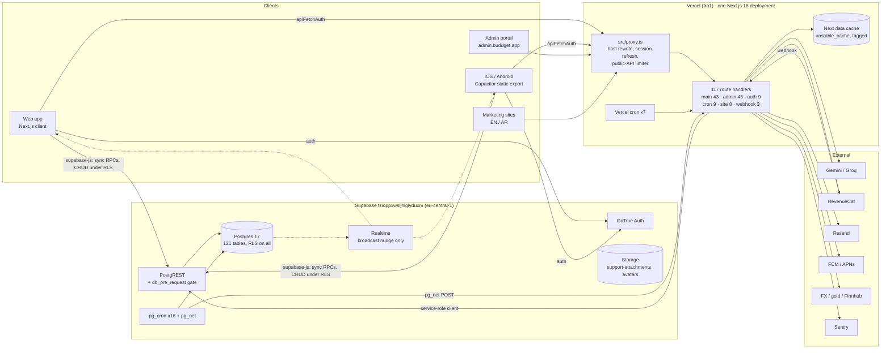
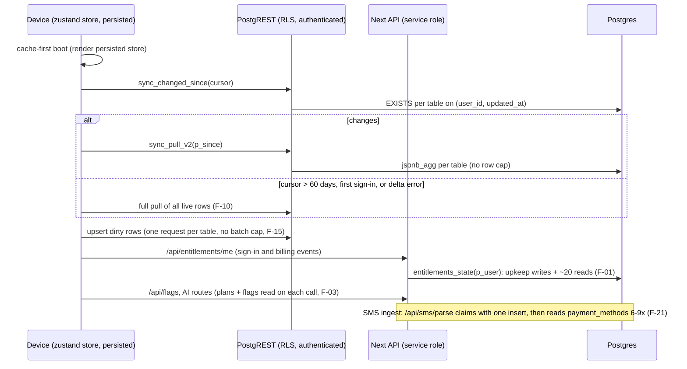
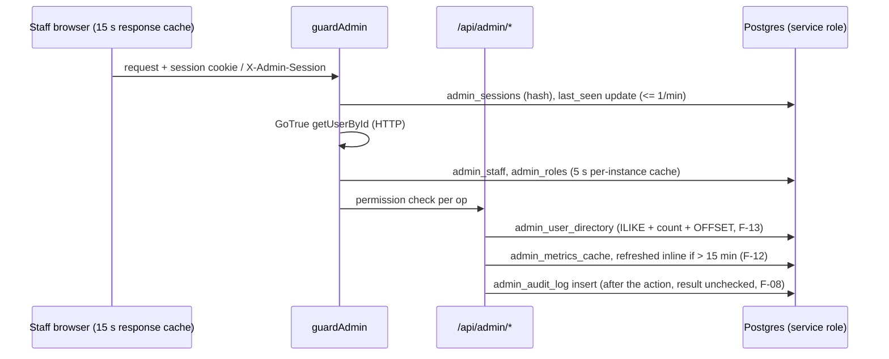
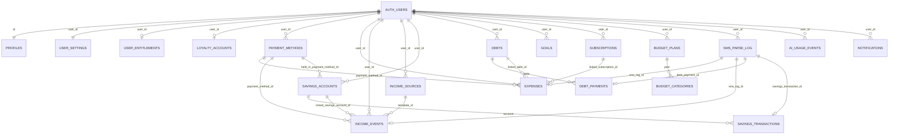

# Architecture diagrams (as of 2026-11-26)

Current state only. No future architecture is drawn: nothing in the audit justifies new infrastructure (see [roadmap, Phase D](performance-optimization-roadmap.md#phase-d-advanced-scaling-trigger-gated)). Sources: `_work/W1a-inventory.md` and the live catalog reads in `_work/W2e-live-db-evidence.md`.

## 1. System overview

Key facts: main app and admin share one deployment, one database and one service-role key (no load isolation). The native apps ship the web bundle locally and call the same API. Receipt photos never leave the device.

## 2. Main app data flow

## 3. Admin portal flow

## 4. Core entity relationships (user-owned finance tables)

A subset of the 121 tables, drawn from live column and index names. Every table below carries `user_id -> auth.users(id)` (84 of 121 tables do). Soft delete (`deleted_at`) exists on 21 tables, `updated_at` on 42.

Schema-wide counts (live): 168 foreign keys (98 `ON DELETE CASCADE`, 68 `SET NULL`, 2 `NO ACTION`), 0 unindexed foreign keys, 22 unique and 202 check constraints, 24 enums, 405 indexes, 0 tables without a primary key, RLS enabled on all 121 tables.
