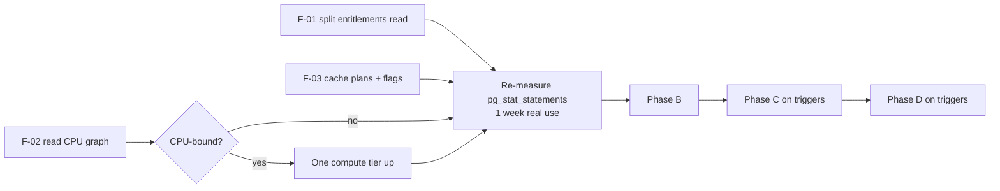

# Performance optimisation roadmap

Date: 2026-11-26. **Plan only: nothing here is implemented, and it waits for the owner's approval.** The findings and evidence are in the [database report](database-performance-audit.md) and the [application report](application-architecture-audit.md#8-finding-register). Effort: S (hours), M (1-2 days), L (about a week), XL (multi-week). Test tier follows `CLAUDE.md` "What to test": items marked **deep** need tests written and run.

## Ordering principle

Fix the measured slow read and the cheap, proven gaps first. Then get real production numbers. Infrastructure changes come only after that. Nothing in Phase D starts without its trigger.

## Phase A: immediate, high value, low risk

| # | Item | Reason / current problem | Proposed solution | App | Deps | Effort | Prio | Risk | Success measure | Evidence that would justify delay |
|---|---|---|---|---|---|---|---|---|---|---|
| A1 | **F-02** read the compute metrics | Instance-wide tails (max 2.5-41 s on cached reads) | Owner checks Supabase Reports, Database CPU, 16-26 Nov; resize one tier only if CPU saturates | Both | Dashboard access | S | P1 | None (read only) | Decision recorded | — |
| A2 | **F-01** make `entitlements_state` a pure read | Mean 433 ms; upkeep writes and a `FOR UPDATE` row lock on every read | Move `rewards_touch` to the daily cron and event hooks (including native first-launch); keep banked-Pro application visible to plan resolution; lock only on a tier change; create the referral code at sign-up; mark the read `STABLE` | Main | Contract test for `/api/entitlements/me` | M | P1 | Missed upkeep path: keep the daily sweep (**deep**) | Mean < 80 ms, max < 1 s over a week | A1 shows the tail is pure CPU, and the mean drops below 100 ms after resizing |
| A3 | **F-03** cache `plans` and `feature_flags` | Read on every paid AI call and every app start; breaks the `CLAUDE.md` cache rule | `cachedSetting` with 60-300 s TTL; make `loadEntitlements` throw on error; add `invalidatePlatformSettings()` to the admin plan and flag routes | Both | — | S | P1 | A plan edit applies after invalidation | `/api/flags` = 2 DB reads; `requireFeature` = 1 | — |
| A4 | **F-04** fix the subscription detector order | Wrong results past the row cap | Group-by RPC (primary), or a descending sort with limit that is reversed in memory | Main | — | S | P1 | Low (**deep**: detection logic) | Unit test with more than 1000 rows keeps the latest | — |
| A5 | **F-07 + F-06** staff lockout DoS, staff enumeration, IPv6 bucket | Anyone can lock out the owner; a locked reply reveals staff; the IP cap is bypassable by IPv6 | `rateBucketIp(clientIp(req))` now (S); uniform 401 when locked (S); then the progressive, (account, IP)-keyed lockout (B2) | Admin | — | S | P1 | None | Test: 2 addresses in one /64 share the bucket | — |
| A6 | **F-09** plan gate and quota before the receipt body | Up to 4 MB parsed before the existing rate layer runs | Run `requireFeature` and `reserveAiQuota` (from `Content-Length`) before `formData()` | Main | — | S | P3 | Low | No body parse when over quota | — |
| A7 | **F-05** cap the avatar size | No DB cap; 164 KB row synced on full pulls and profile deltas | Validator about 300 KB; `CHECK ... NOT VALID`, then validate | Main | Row-size `SELECT` first (done: 1 row, 164 KB) | S | P2 | Existing oversized rows: validate after cleanup | CHECK present; validator test | — |
| A8 | **F-08** audit before irreversible admin actions | Fails open on a DB error between the action and the audit insert | Intent row first, refuse on failure; PII audit fails closed | Admin | — | M | P3 | A blocked action if audit writes fail (intended) | Test: a failed audit insert blocks the delete | — |
| A9 | **F-10a** keep the sync cursor on transient delta errors | One error turns every later boot into a full pull | Retry with backoff; park unreadable rows; only clear the cursor on `needs_full` | Main | — | S-M | P2 | Sync is deep-technical (**deep**) | Full-pull count per device per week ≈ first sign-in only | — |

## Phase B: near-term (next 1-2 cycles)

| # | Item | Proposed solution | App | Deps | Effort | Prio | Success measure | Delay if |
|---|---|---|---|---|---|---|---|---|
| B1 | **F-11** month-carry cron | Due-user RPC, stored cursor, concurrency 4-8, split `loadCycle`; move `sms_run_my_pending_discards()` out of `sync_pull_v2` | Main | A2 not required | M-H | P2 | Full run < 30 s at 10x today's users (seeded) | User count stays below the low hundreds |
| B2 | **F-07** rest of the lockout fix | (account, IP-bucket) failure key, progressive lockout, trusted-device path, lockout email; document F-29 (fails closed on an RPC outage) | Admin | A5 | M | P2 | A stranger cannot lock the owner out | — |
| B3 | **F-12** admin metrics schedule | pg_cron every 30-60 min, stale-while-revalidate, statement timeout; fix the docs; client cache invalidation after writes | Admin | — | S | P3 | Overview p95 < 300 ms | — |
| B4 | **F-14** drop the 4 strict-prefix indexes | One migration; check `pg_stat_user_indexes` first | Both | 30 days of stats preferred | S | P3 | Write latency on sync tables unchanged or better | Any of the 4 shows real scans |
| B5 | **F-15** chunk client writes and `in()` lists | 200-500 rows per upsert, 100 ids per list, check errors | Main | — | M | P3 | No request over about 1 MB; test with 2k rows (**deep**) | — |
| B6 | **F-21** repeated reads | Request-scoped payment methods in SMS dispatch; parallel push lookups; shared notifications fetch | Main | — | M | P3 | SMS booking ≤ 3 `payment_methods` reads | — |
| B7 | **F-18** memory-first gate on public limited routes, plus `Retry-After` | Reuse `publicApiRateLimit` | Main | — | M | P3 | `api_rate_hit` calls per site page view < 0.5 | — |
| B8 | **F-16** unique tie-breakers and `(ts, id)` cursors | Add `id` to orders and cursors | Both | — | S | P3 | No skipped rows in a test with equal timestamps | — |
| B9 | **F-19** welcome retry backoff; **F-20** step-up on bulk actions plus the BUD-94 revert before launch; **F-26** MIME sniff; **F-17** image weights; **F-27** docs | Small, independent | Both | — | S each | P3 | — | — |
| B10 | Observability | Weekly `pg_stat_statements` top-20 snapshot saved to `docs/qa/`, reset only after a snapshot; review F-28 items | Both | — | S | P3 | Snapshot exists each week | — |

## Phase C: growth readiness (trigger-gated)

| Item | Trigger to start | Solution | Effort |
|---|---|---|---|
| **F-10b** paged first pull | p95 full-pull payload > 2 MB or > 3 s on a mid-range Android | Keyset pages per table; on-demand old months later | L-XL |
| **F-13** admin directory | More than about 5k users, or directory p95 > 300 ms | Lean type-ahead RPC, keyset, cached totals | M |
| **F-22** cron sweeps | `sms_parse_log` > 100k rows, a sweep returns `complete: false` twice, or more than 1000 stock holdings | Resume cursors, version-filtered re-mask, distinct-ticker RPC | M |
| **F-25** `(sender, created_at)` index | `sms_parse_log` > 100k rows, or a promotion run > 2 s | One index | S |
| **F-24** batched wipe and streamed export | First account with more than 10k rows in any table | Batched delete RPC; export to Storage | M |
| **F-23** audit-log retention | More than 1M rows or 1 GB, or an owner compliance decision | Monthly partitions plus detach | M |
| Bundle split (W2c-09) | A bundle report shows a first-load JS parse > 1 s on a mid-range Android | Lazy-load rare views with the offline-safe loader | L |
| `useMonthlyStats` shared derivation | Profiling shows > 16 ms per store change on a large seeded account | One derived store keyed by month | M |

## Phase D: advanced scaling (trigger-gated)

| Technique | Trigger | Prerequisites |
|---|---|---|
| Compute tier increases beyond A1 | Sustained CPU > 70% after Phases A-B | Weekly snapshots (B10) |
| Read replica | CPU-bound with reads dominating **after** right-sizing; staleness-tolerant consumers identified (admin analytics, public rates) | Replica lag budget; route-level read/write split |
| Partitioning (`sms_parse_log`, `ai_usage_events`, `app_analytics_events`, `admin_audit_log`) | One table > 50M rows or 20 GB, or retention deletes that overrun | Retention policy; partition-aware unique keys |
| Separate admin analytics store | Admin reports measurably slow user traffic (shared CPU) | B3 schedule, replica first |
| Sharding / distributed Postgres | Not foreseeable; only if one instance cannot hold the write rate after all of the above | — |
| Redis | Only if a shared hot counter outgrows Postgres (for example `api_rate_hit` > 1k writes/s) | B7 first |

## Main app vs admin breakdown

- **Main app:** A2, A3, A4, A6, A7, A9; then B1, B5, B6, B7; then F-10b, the bundle split and stats derivation in Phase C.
- **Admin:** A5 (F-07 + F-06), A8; then B2, B3, B9 (F-20, BUD-94 revert); then F-13, F-24, F-23, F-25 in Phase C.
- **Shared:** A1, A3, B4, B8, B10.

## How success is measured overall

- A weekly `pg_stat_statements` snapshot: top 20 by total time, the mean and max of `entitlements_state`, `sync_pull_v2` and `db_pre_request`, and `api_rate_hit` calls per day.
- Supabase CPU p95 per week.
- Full-pull count per active device per week (client log or a counter in `sync_pull_v2`).
- Admin overview p95 (route timing in logs).
- Zero findings regress: each deep item ships with its test.
